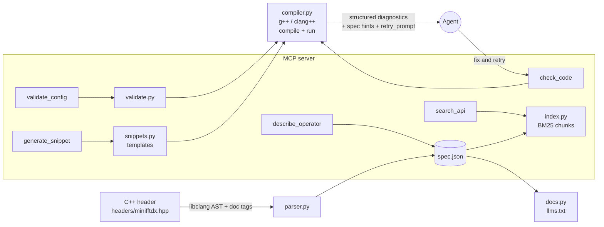

# DxLens: an MCP server that makes C++ math-library APIs LLM-friendly

DxLens parses a template-heavy C++ math-library header with libclang, turns it into a compact
LLM-friendly API spec (JSON + `llms.txt` markdown), and exposes it through an MCP server that can search the API,
validate compile-time configurations, generate usage code from templates, and **compile-check every snippet with the
local compiler, returning diagnostics an agent can use to retry**.

The bundled target is `MiniFFTDx` (`headers/minifftdx.hpp`): a small, host-executable, cuFFTDx-style library
(`Size<256>() + Precision<float>() + Type<fft_type::c2c>() + ...` composed with `operator+`, constraints enforced with
`static_assert`). Because it runs on the CPU, generated programs are compiled **and executed** in tests and evaluation.

## Results first: offline evaluation (30 tasks, deterministic pass/fail)

A task passes only if the generated program **compiles, runs, and prints exactly the expected output**. Expected
outputs are computed independently in Python. Reproduce with `dxlens eval` (about 10 seconds, no network).

| Context given to the model | Budget (tokens) | Context size | Compiles | Pass@1 | Pass with DxLens compile loop (<=2 retries) |
|---|---|---|---|---|---|
| raw header | unlimited | 4595 | 100% (30/30) | 100% (30/30) | 100% (30/30) |
| raw header | 3000 | 2994 | 13% (4/30) | 13% (4/30) | 90% (27/30) |
| raw header | 1500 | 1499 | 3% (1/30) | 3% (1/30) | 67% (20/30) |
| raw header | 750 | 745 | 3% (1/30) | 3% (1/30) | 67% (20/30) |
| **DxLens spec (llms.txt)** | unlimited | 1698 | 100% (30/30) | 100% (30/30) | 100% (30/30) |
| **DxLens spec (llms.txt)** | 3000 | 1698 | 100% (30/30) | 100% (30/30) | 100% (30/30) |
| **DxLens spec (llms.txt)** | 1500 | 1491 | 90% (27/30) | 90% (27/30) | 90% (27/30) |
| **DxLens spec (llms.txt)** | 750 | 744 | 3% (1/30) | 3% (1/30) | 80% (24/30) |

Raw results: `docs/eval/results-scripted.{md,json}`.

**How to read this honestly.**
- The model is a **deterministic scripted stand-in**, not a real LLM. It writes code using *only* the facts its context
  reveals (namespace, operator names, `execute` signatures, property names, the non-asserting `is_supported` trait,
  `size/2+1` r2c output length) and falls back to cuFFTDx-flavoured priors otherwise (wrong namespace, 2-argument
  `execute`, no validity trait). Context is cut at a token budget, as a small context window would.
- So the table measures **how much usable API knowledge survives in a given context budget**, and **how much the
  compile-feedback loop recovers**, not real-model coding skill. With unlimited context both representations
  tie at 100% (the whole 4.6k-token header fits); the spec is ~2.7x smaller (4595 -> 1698 tokens), so it keeps working
  when the budget shrinks. At 750 tokens neither context holds enough, and only the feedback loop rescues the spec.
- The harness has pluggable local-LLM backends (`--model ollama`, `--model llamacpp`) for real measurements; they
  are tested against a stub HTTP server but **no real-model numbers are included** (none was available offline).
- A built-in sanity check requires an oracle (full-spec facts) to solve all 30 tasks before any numbers are reported.
- Tasks come from 8 templated prompt kinds (peak, roundtrip, impulse, r2c, c2r, batch, info, supported), so
  they are varied in parameters, not in phrasing. Treat the benchmark as a regression/measurement tool.

## Features

- **Header parser** (libclang): extracts operator templates (parameter kinds, enum domains), the entry template,
  `static_assert` constraints (class- and method-level, linked to the operators they mention), members, methods, traits,
  helper functions, and usage examples from doc-comment tags into `spec.json` (validated by
  `schema/dxlens-spec.schema.json`) and a compact `llms.txt`. Generated output is committed in `docs/generated/`.
- **MCP server** (stdio): `search_api`, `describe_operator`, `validate_config`, `generate_snippet`, plus
  `list_templates` and `check_code`; resources `dxlens://llms.txt` and `dxlens://spec.json`.
- **Compile-check loop**: gcc/clang diagnostics are parsed into structured records (line, code excerpt, instantiation
  trace mapped back to the user's line, notes) with **spec-derived hints** (violated constraint id and operator domain,
  "namespace is `minifftdx`", did-you-mean, available `execute` overloads) and a ready-made `retry_prompt`.
- **Offline evaluation harness**: 30 tasks, raw header vs. spec, token budgets, with/without feedback loop.
- **Client configs** for Claude Desktop, Claude Code, Cursor and VS Code in `clients/` (optional).

## Architecture



| Module | Role |
|---|---|
| `dxlens/parser.py` | libclang AST walk + doc-tag parsing -> spec dict |
| `dxlens/docs.py` | spec -> `llms.txt`; token counting |
| `dxlens/index.py` | BM25 (`rank_bm25`) over per-symbol chunks, camelCase-aware tokenizer, small synonym table |
| `dxlens/validate.py` | config -> operator expression, preflight domain checks, compile probe that prints resolved properties |
| `dxlens/snippets.py`, `templates/*.tmpl` | 7 code templates (`fft_peak`, `roundtrip`, `impulse`, `r2c_peak`, `c2r_roundtrip`, `batched`, `properties`) |
| `dxlens/compiler.py` | compile/run with timeouts, diagnostics parsing, hints |
| `dxlens/service.py`, `server.py`, `cli.py` | transport-independent core, FastMCP wrapper, CLI |
| `dxlens/eval/` | tasks, context scrapers, scripted/Ollama/llama.cpp models, harness |

## Setup

Requires Python 3.10+ and a C++17 compiler (`g++` or `clang++`).

```bash
python3 -m venv .venv && source .venv/bin/activate
pip install -r requirements.txt
pip install -e .                 # installs the `dxlens` and `dxlens-mcp` commands
cp .env.example .env             # optional; every variable has a safe default
```

No secrets or external services are needed. Configuration is read from environment variables / `.env`
(see `.env.example`). libclang comes from the `libclang` pip wheel; DxLens borrows the host compiler's include directory
for system headers.

## Run

```bash
dxlens build                                    # headers/minifftdx.hpp -> docs/generated/{minifftdx.spec.json,minifftdx.llms.txt}
dxlens search "threads per fft"
dxlens describe Size
dxlens validate '{"Size":256,"Precision":"fp32","Type":"c2c","Direction":"forward"}'
dxlens snippet fft_peak '{"Size":256,"Precision":"fp32","Type":"c2c","Direction":"forward"}' --params '{"frequency":5}'
dxlens check my_program.cpp                     # compile-check; add --run to execute
dxlens serve                                    # MCP server over stdio (same as: python -m dxlens.server)
dxlens eval                                     # offline evaluation -> docs/eval/
dxlens eval --model ollama --budgets unlimited,1500   # optional local LLM (OLLAMA_URL / OLLAMA_MODEL)
```

Use another header with `DXLENS_HEADER=/path/to/header.hpp` (it must follow the Dx-style conventions below).
Register the server with a client using the files in `clients/` (see `clients/README.md`). A recorded-style walk-through
with real tool output is in [`docs/demo-transcript.md`](docs/demo-transcript.md).

## Test

```bash
pytest          # 61 tests: parser, docs/index, diagnostics, validation, snippets (compiled and executed),
                # a real MCP stdio session, evaluation harness incl. oracle solving all 30 tasks
```

## Key design decisions

- **Real AST, not regexes.** libclang gives exact template-parameter kinds, signatures and `static_assert` conditions
  and messages. Intent that C++ cannot express (required/default/range/pow2, examples, entry/operator roles) comes from
  doc-comment tags (`@dx_operator`, `@dx_entry`, `@required`, `@default`, `@range`, `@pow2`, `@example`).
- **The compiler is the source of truth for validity.** `validate_config` never re-implements library rules: it maps
  the config to operators, runs only cheap structural/domain preflight checks, then compiles a probe so the library's own
  `static_assert`s decide. Failures are mapped back to constraint ids in the spec (a test checks the domain warnings never
  disagree with the compiler). On success it returns resolved properties (threads per FFT, shared memory, ...).
- **Method-level `static_assert`s are part of the spec.** The offline evaluation exposed that misuse errors such as
  "execute(...) is only available for c2c" had no hint; extracting them fixed the compile loop.
- **Structured diagnostics + hints, not raw compiler dumps.** gcc prints instantiation traces *before* the error, so
  traces are attached to the following diagnostic; curly quotes are normalised; the library-side line is mapped back to
  the user's line.
- **BM25 over symbol-level chunks** (`rank_bm25`): offline, dependency-light, enough for a few hundred symbols. SQLite/FAISS
  were skipped deliberately; embeddings add weight without a clear gain at this scale.
- **Safety.** `generate_snippet` only runs code rendered from fixed templates. `check_code(run=true)` executes
  agent-written programs only when `DXLENS_ALLOW_RUN=1`; compile and run both have timeouts. Run it in a container or
  sandbox if you enable that.
- **Pinned MCP SDK** `mcp>=1.2,<2` (FastMCP API); the 2.x SDK renamed the server API.

## Limitations

- One entry template per header (`@dx_entry`), and the description-composition pattern (`A() + B()`) is assumed by
  `validate_config`/`generate_snippet`; other libraries need their own templates.
- Snippet templates and evaluation tasks are specific to FFT-style libraries; the evaluation's model is scripted (see above).
- Tested with g++ 13 and libclang 18; clang++ diagnostics parsing is covered by unit tests on sample output, not a live clang run.

## How to present it

- **Lead with the results table above**, then the diagram, then [`docs/demo-transcript.md`](docs/demo-transcript.md): an agent
  asks for "a 256-point fp32 FFT", gets a validated configuration, makes one wrong guess (wrong namespace), is told exactly why
  by the hints, and ends with compiling code that runs and prints `peak_bin=5 peak_mag=128.000`. For a live recording, add
  `clients/claude_code.mcp.json` as `.mcp.json`, start Claude Code in this repo, and ask for that FFT.
- **Talking points:** the spec is ~2.7x smaller than the header; under a 1,500-token budget the pass rate of generated code
  rose from 3% (raw header) to 90% (spec), and the compile-feedback loop lifted the raw-header case from 3% to 67%.
  State that the model is scripted and say what that does and does not show; offer `--model ollama` as the next step.
- **CV line:** "Built an MCP server and API-to-LLM spec generator for C++ template libraries (libclang, BM25, compile-check
  loop); raised compile-and-run success of generated code from 3% to 90% on a 30-task offline benchmark at a 1.5k-token context
  budget (scripted-model harness; local-LLM backends included)."

## Repository layout

```
dxlens/            package (parser, docs, index, validate, snippets, compiler, service, server, cli, eval/)
headers/           sample Dx-style library (MiniFFTDx)
schema/            JSON schema for the generated spec
tests/             pytest suite
clients/           MCP client registration configs (optional)
docs/generated/    committed spec.json + llms.txt;  docs/eval/ evaluation results;  docs/demo-transcript.md
```
